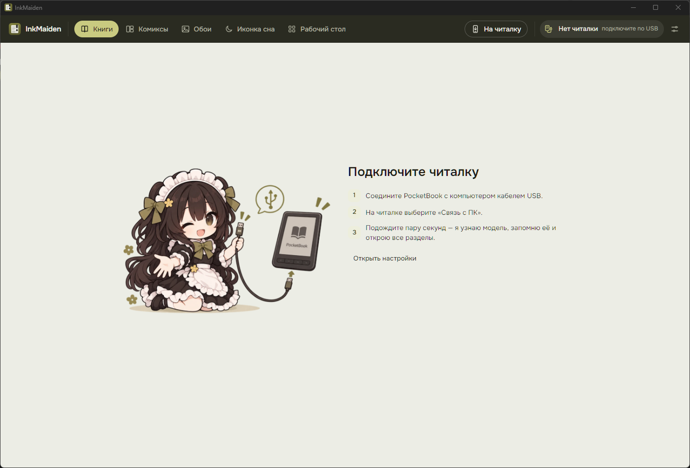

<<<<<<< HEAD
=======

>>>>>>> 0ab3e1312ec253044555bb0a7f9b1ba84711569c
# InkMaiden

**Ваша персональная мастерская для PocketBook.**

InkMaiden - программа для управления электронной библиотекой, подготовки книг, персонализации и обслуживания устройств PocketBook. Она объединяет множество инструментов в одном интерфейсе и помогает выполнять повседневные задачи без необходимости использовать отдельные программы и вручную работать с файлами устройства.

> [!WARNING]
> **Внимание! Программа находится на стадии Pre-Alpha.**
>
> Разработка ещё продолжается, поэтому некоторые функции могут работать нестабильно, а в отдельных местах могут встречаться ошибки. Перед использованием важных инструментов рекомендуется создавать резервные копии данных.

## Оглавление

1. [Начало работы](#1-начало-работы) - подключение PocketBook и знакомство с программой.
2. [Управление книгами](#2-управление-книгами) - организация библиотеки, обложки, редактирование и конвертация.
3. [Манга и комиксы](#3-манга-и-комиксы) - подготовка и организация графической литературы.
4. [Персонализация](#4-персонализация-устройства) - создание обоев и оформление читалки.
5. [Файлы и загрузки](#5-работа-с-файлами-и-загрузками) - подготовка материалов и перенос на устройство.
6. [Информация и диагностика](#6-информация-и-диагностика-устройства) - сведения об устройстве и проверка его состояния.
7. [Резервное копирование](#7-резервное-копирование) - сохранение и восстановление файлов.
8. [Системные инструменты](#8-дополнительные-системные-инструменты) - дополнительные возможности обслуживания и настройки.
9. [Особенности и безопасность](#9-особенности-и-безопасность) - важные принципы работы программы.
10. [Совместимость](#10-совместимость-и-тестирование) - проверенные устройства.
11. [Техническая информация](#11-техническая-информация) - используемые технологии.

## 1. Начало работы

Для начала работы достаточно выполнить несколько простых действий:

1. Подключите PocketBook к компьютеру с помощью USB-кабеля.
2. Запустите InkMaiden.
3. Дождитесь автоматического определения подключённого устройства.
4. Выберите нужный раздел в программе.
5. Выполните необходимые действия.

Если вы впервые используете InkMaiden, рекомендуем сначала ознакомиться с основными разделами ниже.

## 2. Управление книгами

Всё необходимое для организации и подготовки электронной библиотеки:

- Просмотр и управление книгами на компьютере и устройстве.
- Добавление и редактирование обложек.
- Редактирование содержимого книг, удаление рекламы и лишних элементов.
- Конвертация текстовых файлов TXT в FB2.
- Подготовка книг к переносу на PocketBook.

## 3. Манга и комиксы

Инструменты для подготовки и организации графической литературы:

- Управление мангой и комиксами.
- Организация серий и файлов.
- Подготовка материалов для удобного чтения на PocketBook.

## 4. Персонализация устройства

Настройте внешний вид читалки под себя:

- Создание собственных обоев.
- Подготовка и установка изображений для экрана сна.
- Оформление рабочего стола.
- Настройка визуального оформления устройства.

## 5. Работа с файлами и загрузками

Удобный способ подготовить материалы и перенести их на устройство:

- Управление загруженными и подготовленными файлами.
- Разделение материалов по этапам обработки.
- Просмотр файлов, предназначенных для переноса на читалку.
- Управление загрузками в одном месте.

## 6. Информация и диагностика устройства

Получите больше информации о своём PocketBook:

- Автоматическое определение модели устройства.
- Сбор доступных системных сведений.
- Просмотр информации о состоянии аккумулятора и памяти, если эти данные доступны.
- Анализ состояния устройства.
- Дополнительные инструменты диагностики.

## 7. Резервное копирование

Защитите важные файлы и результаты своей работы:

- Создание резервных копий.
- Сохранение предыдущих версий файлов.
- Восстановление файлов из резервных копий.
- Возможность вернуться к исходному состоянию при необходимости.

## 8. Дополнительные системные инструменты

InkMaiden предоставляет дополнительные возможности для обслуживания и настройки PocketBook, включая управление доступными приложениями и работу со сторонними инструментами.

## 9. Особенности и безопасность

- **Единое рабочее пространство** - основные инструменты для работы с книгами и устройством собраны в одной программе.
- **Автоматическое определение устройства** - не нужно каждый раз вручную указывать подключённый PocketBook.
- **Сохранение оригиналов** - программа учитывает исходные файлы и резервные копии.
- **Защита от лишнего копирования** - учитываются файлы, которые уже присутствуют на устройстве.
- **Удобный процесс подготовки** - от загруженного файла до готовой книги на читалке.
- **Без модификации прошивки** - для обычной работы не требуется jailbreak или установка изменённой прошивки.

## 10. Совместимость и тестирование

На данный момент основные функции программы тестировались на следующих устройствах:

- PocketBook Verse
- PocketBook InkPad Color 3

На других моделях PocketBook программа может работать, но полноценная проверка совместимости пока не проводилась. Если вы используете другую модель, буду рад обратной связи о работе InkMaiden на вашем устройстве.

## 11. Техническая информация

InkMaiden разработана с использованием следующих технологий:

- Rust
- Tauri 2
- HTML / CSS / JavaScript

---

**InkMaiden - больше, чем просто библиотека. Это мастерская для вашей читалки.**
